+++
title = "Secrets of a Cheap Children's Smart Watch"
date = 2026-11-17
draft = false
tags = ['Research','IoT','Hardware']
Summary = "My research into the Blackview Z30 Children's Smartwatch."
+++

---

### Introduction

Toys must be safe for children to use, but smart toys expose a whole extra dimension of risk to be managed. If you visit a site like AliExpress, there are countless toys, both regular and smart, available for purchase. But what cyber risks do the smart toys expose children to? And more importantly, what steps have all these manufacturers taken to mitigate such risks? This brings me to today’s subject, the Blackview Z30:

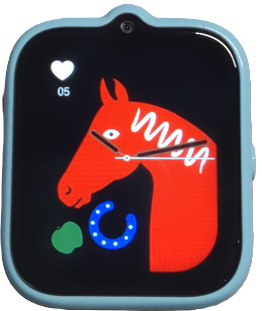

The Blackview Z30 is a Chinese budget smartwatch designed for children, boasting 4G cellular capability. However, it must be paired with an app called SeTracker2 for full functionality. For example, once registered to the app, the watch can be used to track the wearer’s physical location. 

In China, these smartwatches are a phenomenon in and of themselves[^footnote]. Parents see them as a sensible alternative to the smartphone, primarily because they are easier to control and have fewer features. As a bonus, they can see if their child made it to school safely that morning. These devices are also on the global market and are available where I live. So given the vulnerable demographics involved, I am curious to see what security measures white-label brands like Blackview have taken at the budget level.

---
 
### Setracker 2

Each watch has a unique code for registration to SeTracker2. You get the code when navigating to the 
pertinent menu on the watch, which downloads it from SeTracker2's servers. Once the code is 
entered into the app, the watch is "bonded" to your account, and you can interact with it.

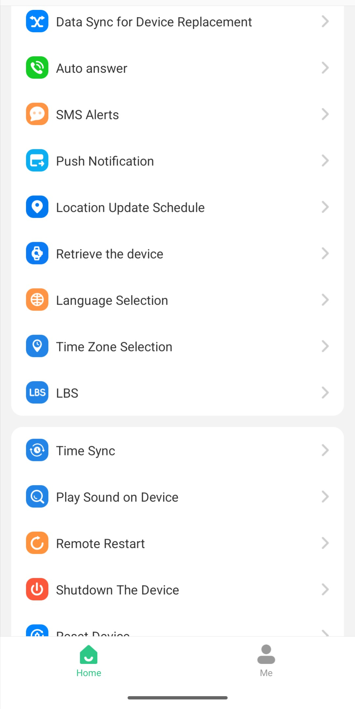
_Features available to in Setracker2._

SeTracker2 has a history of vulnerabilities. In 2026, security 
researchers stalked a journalist by exploiting vulnerabilities within the app[^footnote2]. There are also some quite serious CVEs in the NIST database[^footnote3]. And in 2020 researchers at Pen Test Partners found many vulnerabilities in devices that use SeTracker2 as a backend[^footnote4].
  
For my research, I wanted to focus on a children's smartwatch at a hardware and firmware level. SeTracker2's history of security issues is known, and I wanted to avoid retreading old ground investigating the app. 

---

### Factory Mode Menu

After messing with the device for a bit, 
I found a hidden factory mode menu. 

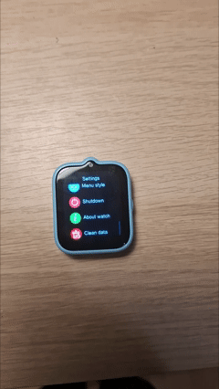
_Accessing factory mode._

Factory mode is just a quick way to trigger functions throughout the RTOS. For example, 
if I want to test the camera, the camera function works as it would if I selected it from the user menu. 
The only difference is that it can be marked faulty or non-faulty. This is important at the factory, helping to ensure that faulty
watches get caught before they reach consumers.

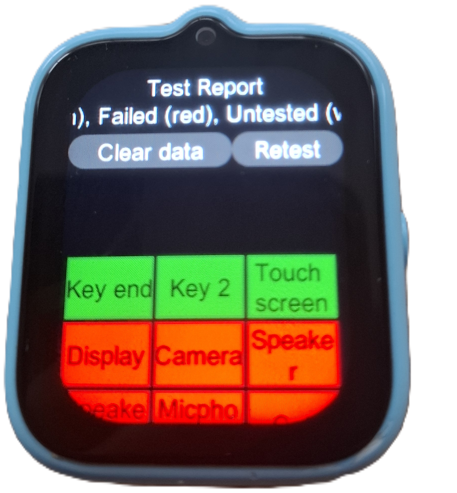
_A test menu in factory mode. Red indicates faulty, while green indicates non-faulty._

I am unconvinced that there are more “secret menus” mainly because the SoC the Blackview Z30 runs on is resource-poor. Thus, it would make little sense to squeeze in another menu when factory mode already allows access to most of, if not all, the functions the Blackview Z30 is capable of. Furthermore, the device depends wholly on SeTracker2 for most of its functionality. For example, during testing, I changed the internal time on one of my watches. This was with a watch not bound to SeTracker2. When I then tried to download the registration code for the watch, I ran into what seemed to be a TLS issue, and had at best a fancy paperweight with a calculator that wasn’t even scientific. 

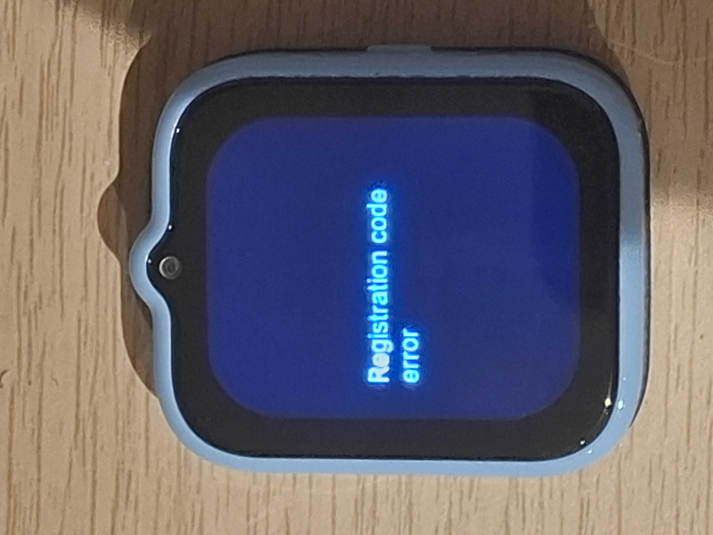
_Registration code error message._

This is an extremely limited device. There are no “cool secret admin panels” simply because there is nothing cool and secret to protect. Therefore, without a full teardown, we can go no further.

---

### Hardware Teardown

I quickly ran into a problem, the chassis of the watch is PE plastic and IP68 waterproof. The tools I had on-hand only scratched the paint at most, so I purchased a hobby saw intended for plastic modelling[^footnote5]. As a further complication, the device is powered by a lithium-ion battery, so I had to be careful where I sawed. I surmised that the battery was likely below or near to the charging contacts at the back; therefore, the safest point of entry was to cut off the front plastic. Once I had an opening, I could cautiously pry open the watch from there. 

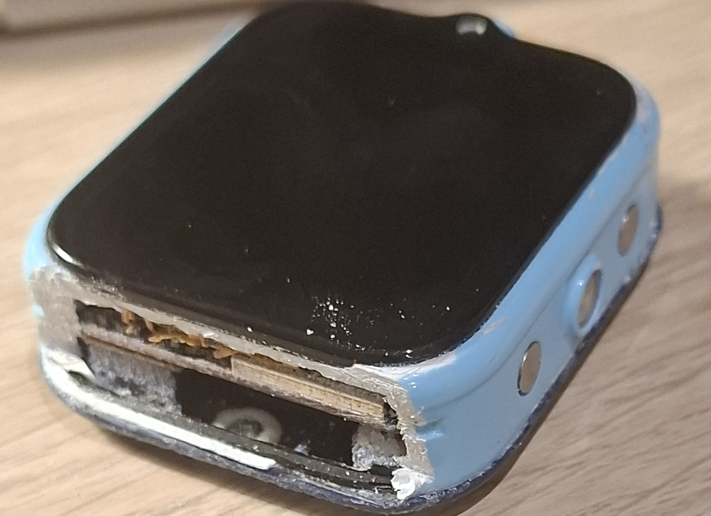
_The watch with some of its front plastic torn off._

After much drudgery with my modelling saw and a pair of pliers, I created 
an opening—damaging the screen connector in the process. But from here, it was just a matter of pulling the watch apart while avoiding the battery. 

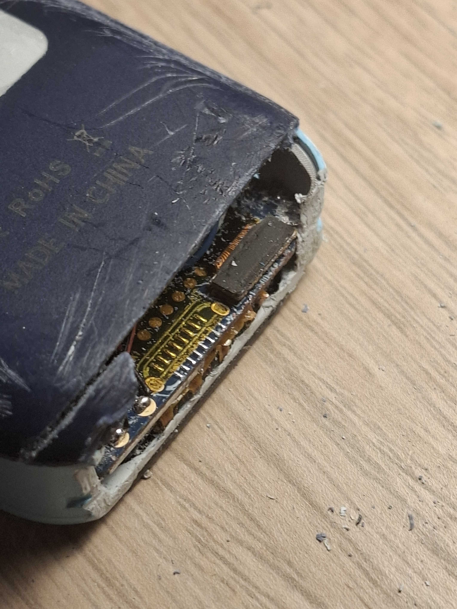
_Exposing some test pads inside the watch._

In my teardown, I had exposed an interface of sorts. However, I couldn’t see what it was, and the chassis blocked my access. The battery was also still a risk, so I disconnected it and fully removed the PCB from the chassis. 

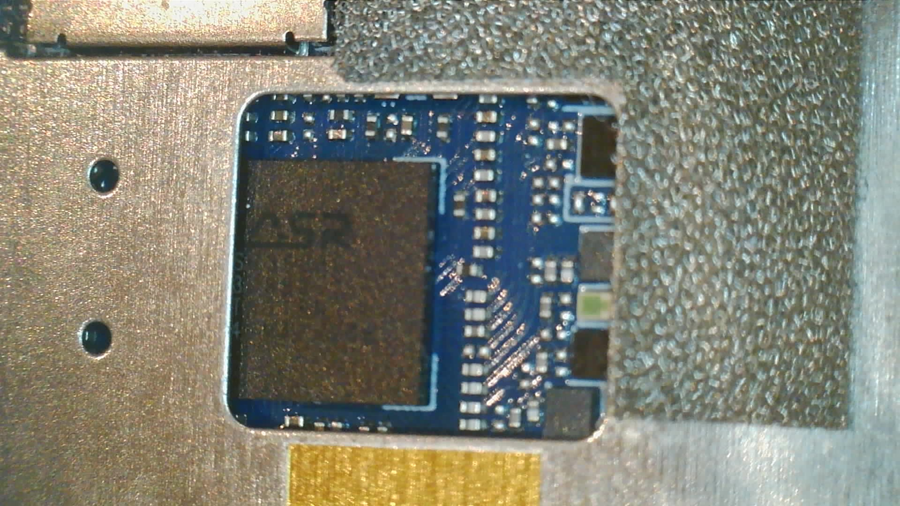
_The ASR 3603 SoC partially hidden behind an EMI shield._

When examining the PCB, I could confirm an important detail I found about the device online, it uses an ASR 3603 SoC[^footnote6]. 

ASR MicroElectronics is a Chinese semiconductor company. Many of their products revolve around smartphones, wearables, and other IoT devices. The ASR3603 is, as I alluded to earlier, a limited chip, featuring an ARM Cortex-R5 clocked at 832MHz. Storage-wise, it has 16 MB RAM, and 24MB ROM integrated onto the chip. These limitations necessitate much of the Blackview Z30’s functionality being done on the network. 

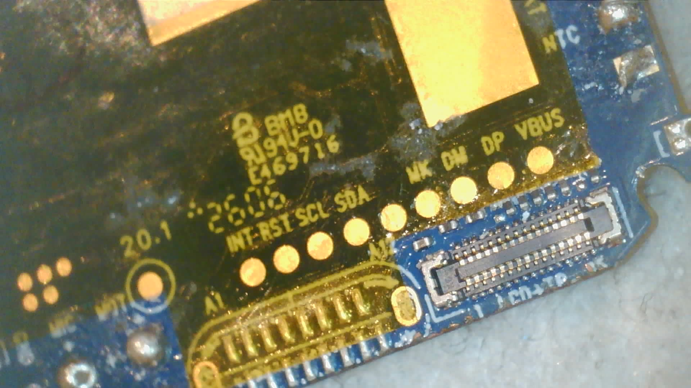
_An I2C and USB interface exposed._

There were two interfaces toward the bottom of the PCB. I2C, and what looks like USB. I suspect the I2C interface is used for a sensor, perhaps the temperature sensor. While the USB interface is more interesting, as I think it’s a test interface for the connector we are about to discover.

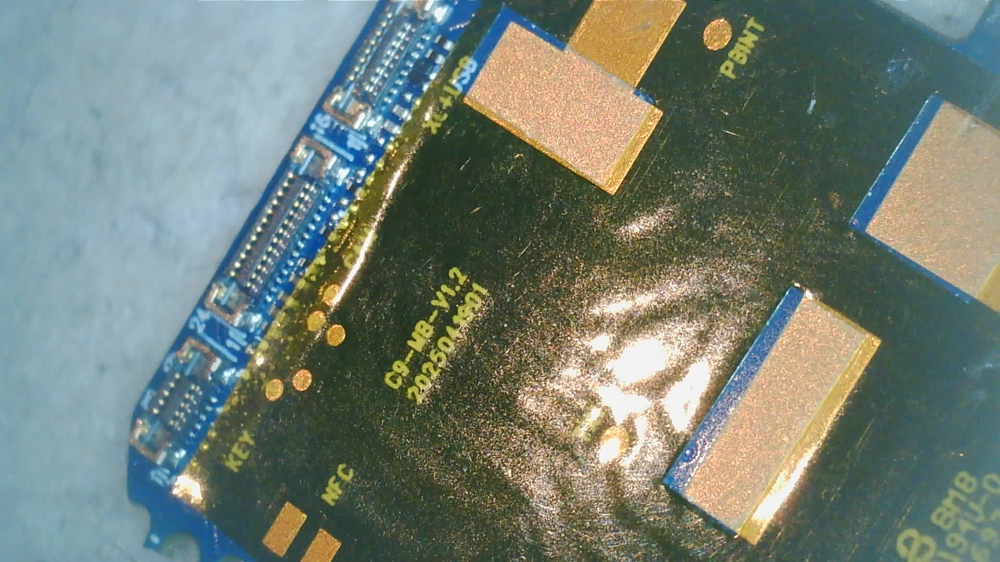
_ZIF Connector Sockets on the PCB._

The top of the PCB features ZIF sockets. One for the side buttons, another for the camera and microphone, with a third for a USB connection. 

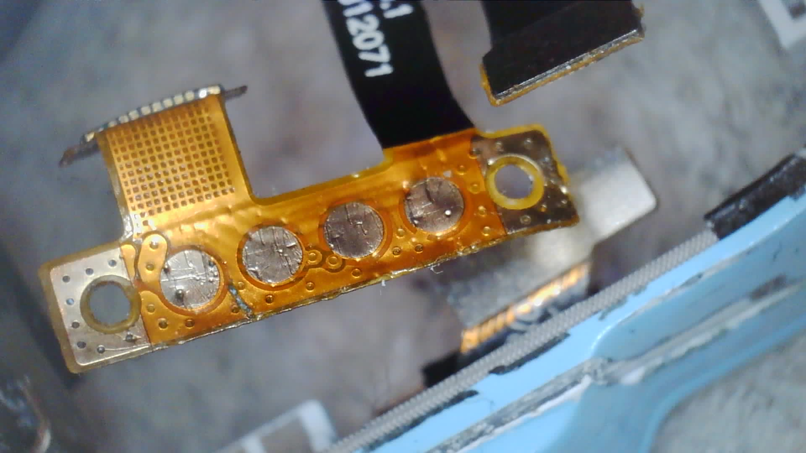
_ZIF Connector for USB._

Connecting to these four pads are four pogo pins that protrude from below the charging contacts. 

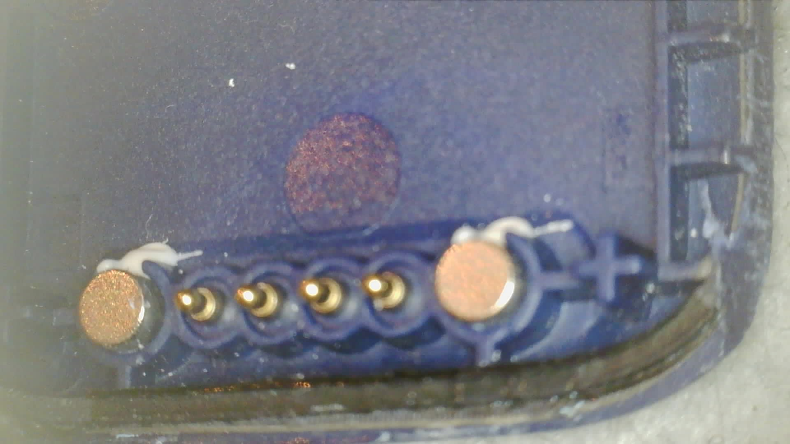
_Internal pogo pins._
 
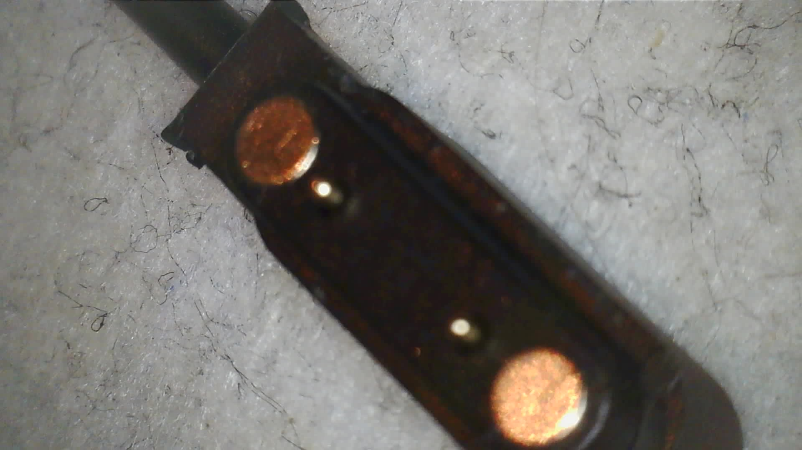
_The charger included with the Blackview Z30._
 
Because Blackview wants the watch to be waterproof, they forwent the headache of adding a USB port (the charger pictured above uses USB-A at the other end.) Instead, the watch uses magnets and pogo-pins that connect to the internal USB ZIF socket. 

Blackview gives the consumer a 2-pin cable, probably to save on cost. However, this omits the two middle pins USB uses for data connectivity. Fortunately, I came across a Chinese patent which suggested that a variant of this cable existed with all four pins, designed for use with children’s smartwatches[^footnote7]. 

The patent confirmed that data transmission was possible, but until this point, I didn’t know what was on the other side of the charging contacts. Now that I did, finding a cable with all four pins was the best way forward. Luckily for me, such a cable was inexpensive and easy to find. If you type "magnetic smartwatch charger" into Amazon or similar and purchase one with four pins, you should be able to get a connection.

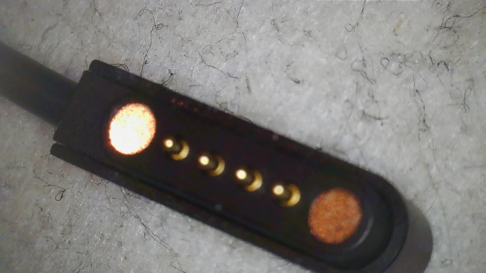
_A four pin version of the charging cable._

---

### Connecting to The Watch

You will need the right drivers for a working connection with the watch. The relevant ASR flashing tool and drivers were leaked 
from ASR and are available to download somewhere on the internet. The legitimate SHA-256 file hashes are as follows: 

- DrvInstaller.exe SHA-256 Hash: 625DB9BDAE215014A57C0C321BECAAA7FD2AFCF72621711DCA4B72495C5B2398
- DrvInstaller_x64.exe SHA-256 Hash: 39289DC3F693D6DF4C15EDD62BF41856F3E4B2F2926D4A02942B0891B0D65D17 
- aboot.exe (ASR_Flashing_Tool_2022.04.30) SHA-256 Hash: 79FA5378EFD824D14A7568C8B224EC427DEF291A6F54FDB60EF6177E92116E84 

**Trust, but verify.** 

A matching checksum confirms the file you downloaded matches the file used to generate the checksum. However, this does not guarantee it is authentic if the download source or checksum are compromised. If you are going to find these files for yourself, please do your own due diligence. 

Connecting the watch to my computer exposed three COM ports.

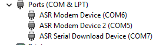
_Three COM Ports, 5, 6, and 7._

COM Ports 5 and 6 connect to a cellular modem interface. As seen in both the GIF and image below, it is possible to 
send basic commands to the interface.

_The cellular modem interface._

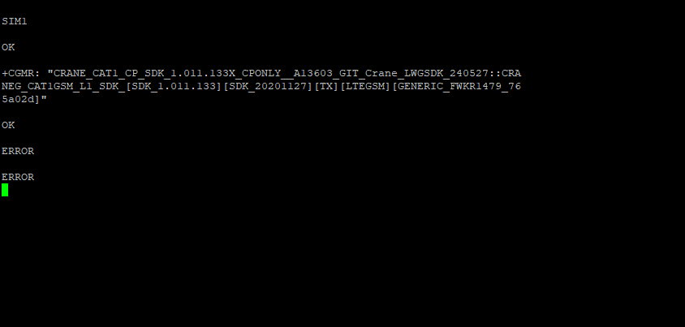
_Some commands on the AT Interface._

COM Port 7 on the other hand shows unadulterated system output. We cannot interrupt this or send commands ourselves, 
only observe the entropy of it all:

_COM7 output._

#### A word on firmware

_The ASR flashing tool._

In theory, you can flash a custom firmware image onto the device, presuming secureboot doesn't get in the way. 
However, we would need the proper software packages, and also documentation on how to communicate with the proprietary hardware 
on the Blackview Z30. At the time of writing, both of these are unavailable.

It is possible to dump the device’s firmware. In fact, there is a tool available for the ASR3603 that allows you to dump the chip’s memory[^footnote8]. But it is expensive, and de-soldering BGA chips requires careful precision work, so I have not done it myself. This said, we know the ASR3603 supports ThreadX RTOS and AliOS[^footnote6], so the Blackview Z30 likely runs a version of one or the other, with a config file pointing at Setracker2’s servers. 

If you look at children's smartwatches on AliExpress and other outlets for long enough, you will notice they share 
similar, if not the exact same UI elements. Therefore, it is likely that all these white-label smartwatches are clones of one another under different names, 
flashed at the factory the same way with minor adjustments here and there.

---
### SMS filter bypass vulnerability

The Blackview Z30 user manual documents a command you can send to the watch via SMS. Early into my research, 
I did some digging and found that the SeTracker2 eco-system of watches supports a documented series of commands. 
Some worked on the Blackview Z30, while others did not. The below images are a selection of commands I tested and confirmed to 
work, but if you want to test some for yourself, there are lists of commands available online[^footnote10].

The default command interface is your password, which is 123456 by default, followed by your chosen command and terminated by #. 
You must be very exact; even the slightest bit of white-space can cause a watch not to recognise a command at all. 

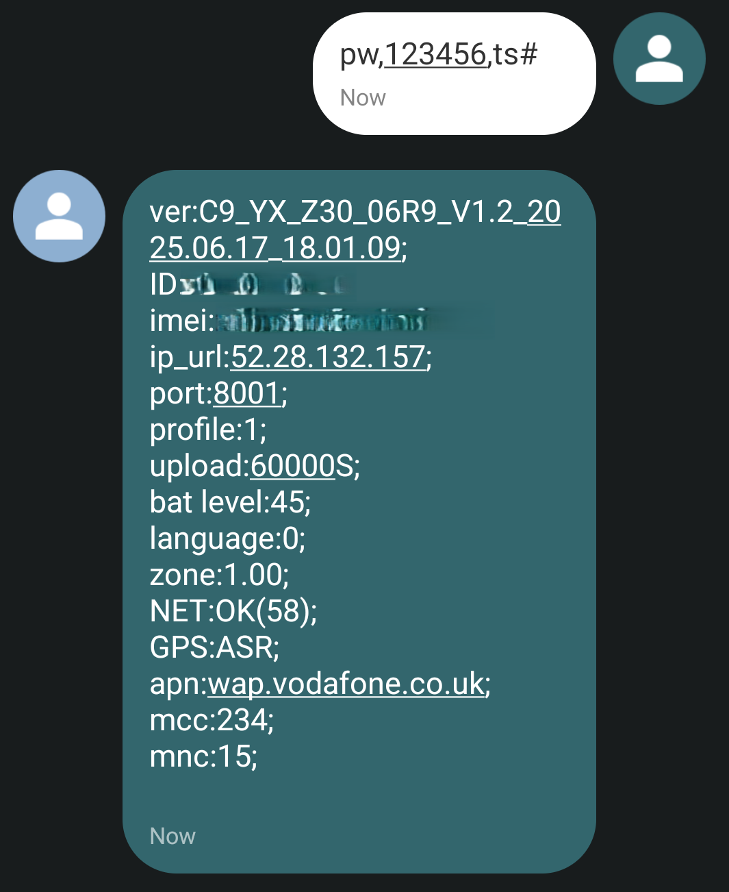
_The TS command._

_The IMSI command._

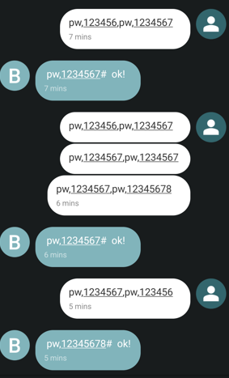
_Change password command._

There is also the reset command, which restarts the watch. As with other commands, this works even with the SMS filter enabled. To demonstrate, I have recorded a video demo of the reset command in action. 



Rapid7 first documented this vulnerability in 2019[^footnote9], and its still an issue for the Blackview Z30. I contacted Blackview some weeks ago, informing them of this matter, but they are yet to respond. If they ever do, I will update this post. In the meantime, though, this shows the issue persists in SeTracker2 watches years later. 

While you would need the watch’s number and password to trigger the vulnerability, there are still things to consider. For one thing, the default password is 123456, and if you wanted to change the password, you would need to find the command yourself as Blackview does not disclose it. There is also the matter of needing to trust every individual who knows the watch’s number. Though you can “harden” the device by simply changing the password from its default value, which I demonstrated how to do in this post.

---

### Conclusion

The Blackview Z30 relies on a security through obscurity model and is a cellular SoC hidden behind a plastic mold. That said, I did not set out intending to label the device as terribly insecure, or extremely secure. Rather, I believe the security community plays an important role in helping consumers make informed choices about devices. One way the community can do this is by evaluating what value manufacturers like Blackview place in device security. 

With these SeTracker2 smartwatches, I agree with Huancheng Hu and Christian Doerr, researchers at the University of Potsdam[^footnote11]. There is little incentive for manufacturers to spend time and effort on more mature security models. As Huancheng and Christian point out, resellers of these watches often have minimal control over the firmware and hardware of the devices, and so a mature security model may be at least somewhat out of their hands.  

Manufacturers will take a basic SoC, seal it in plastic, flash firmware onto it, and send it out to the world. Mostly, this delivers watches functional enough for consumers to keep buying them. Chances are, for as long as it is a viable business model, we will continue to see more of these watches pop up everywhere.

---

### References

[^footnote]: https://www.wsj.com/world/china/why-helicopter-parents-in-china-buy-watches-not-phones-for-their-kids-3874470f
[^footnote2]: https://www.wired.com/story/hackers-stalked-me-by-hijacking-a-smartwatch-for-kids/
[^footnote3]: https://www.cve.org/CVERecord/SearchResults?query=Setracker2
[^footnote4]: https://www.pentestpartners.com/security-blog/hacking-smart-devices-to-convince-dementia-sufferers-to-overdose/
[^footnote5]: https://amzn.eu/d/0fVRN1D1
[^footnote6]: https://www.asrmicro.com/en/goods/proinfo/55.html 
[^footnote7]: https://patents.google.com/patent/CN210015335U/en
[^footnote8]: https://multi-com.eu/,details,id_pr,23138,key,asr-nor-adapter-for-3603-soc.html
[^footnote9]: https://www.rapid7.com/blog/post/2019/12/11/iot-vuln-disclosure-childrens-gps-smart-watches-r7-2019-57/
[^footnote10]: https://www.scribd.com/document/677824850/GPS-setracker-SMS-command-list-English
[^footnote11]: https://dl.acm.org/doi/pdf/10.1145/3779208.3785278

 
